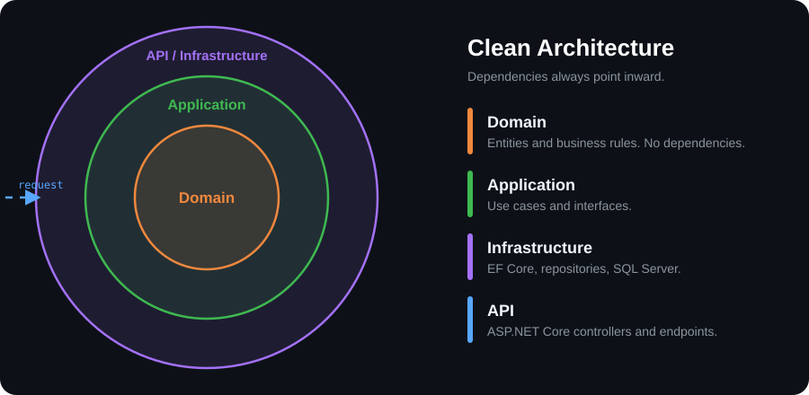

<div align="center">



<br/>
<br/><br/>
<a href="https://www.linkedin.com/in/mohamedhhh/"></a>
<a href="mailto:mohamedheshameldesouky@gmail.com"></a>


<br/><br/>

<a href="https://github.com/MMohamedHeshamm">
  
</a>

<br/>

<!--  -->

</div>

---


```csharp
public sealed class MohamedHEldesouky
{
    public string Role => "Backend Engineer & Technical Project Coordinator";
    public string Company => "EVA Pharma";
    public string Location => "Cairo, Egypt";

    public string[] TechStack => new[]{ "C#", "ASP.NET Core", "SQL Server" };

    public string[] Focus => new[]{ "RESTful APIs", "MVC Projects", "Technical Coordination" };

    public string[] Learning => new[]{ "Clean Architecture", "Design Patterns", "System Design" };

    public bool OpenToOpenSourceCollaboration => true;
}
```

I'm a **Backend Engineer & Technical Project Coordinator at EVA Pharma**, focused on backend development, code reviews, and reliable software delivery. I enjoy building maintainable applications, reviewing APIs and database designs, and helping teams solve technical challenges.

- 🌱 **Currently exploring:** Clean Architecture, Design Patterns, System Design, and advanced ASP.NET Core.
- 🤝 **Open to collaborating on:** open-source .NET projects, RESTful APIs, and backend systems.
- 💬 **Ask me about:** C#, ASP.NET Core, EF Core, SQL Server, Git, and backend development.

---


**🚀 Backend Development**


**🗄️ Databases**


**🌐 Frontend Development**


**💻 Other Programming Languages**


**🛠️ Development Tools & Version Control**


**🎨 Design & Productivity Tools**


---

## 🚀 What I Do

| | Focus | What I Work On |
|:---:|---|---|
| 🧩 | **Backend Development** | RESTful APIs and data-driven applications with C#, ASP.NET Core, EF Core, and SQL Server. |
| 🔍 | **Code Quality & Architecture** | Reviewing code, APIs, database structures, and software design for maintainability. |
| 🤝 | **Technical Coordination** | Mentoring teams, resolving blockers, and tracking software delivery milestones. |

---


<div align="center">
  
</div>

**Clean Architecture** is one of the approaches I'm currently exploring in .NET: keeping domain logic at the center, organizing use cases in the application layer, and separating infrastructure concerns such as EF Core and database persistence. The diagram illustrates the architectural model I'm learning about; it does not claim that every project I've worked on uses this exact design.


---

## 🏆 Highlights

- 🏢 **EVA Pharma (2025–Present)** — Backend Engineer & Technical Project Coordinator, supporting code reviews, mentoring, and software project delivery.
- 🎓 **Ain Shams University (2024)** — B.Sc. in Computer Science; earned an **A** on a GAN-based sketch-to-image graduation project.
- 💻 **Digital Egypt Pioneers Initiative (DEPI, 2024)** — Completed six months of .NET web development training.
- 👨‍🏫 **iSchool (2024)** — Worked as a part-time coding instructor, helping younger learners develop programming skills through hands-on projects.

---


| Project | Description |
|---|---|
| [**Talabat API Solution**](https://github.com/MMohamedHeshamm/Talbat.G04.SolutionMan) | C# solution organized into API, Core, Repository, and Service projects. |
| [**Simple Marketplace**](https://github.com/MMohamedHeshamm/Simple-MarketPlace) | Online marketplace solution developed during .NET training. |
| [**Online Shop — Flutter**](https://github.com/MMohamedHeshamm/Online-Shop-Flutter) | Cross-platform shopping app project built with Flutter and Dart. |

Explore more on my [GitHub repositories page](https://github.com/MMohamedHeshamm?tab=repositories).


<div align="center">

### 📫 Let's Build Something Together

<a href="https://www.linkedin.com/in/mohamedhhh/"></a>
<a href="mailto:mohamedheshameldesouky@gmail.com"></a>
<a href="https://www.youtube.com/@mh-technical3072"></a>

<br/><br/>


</div>
